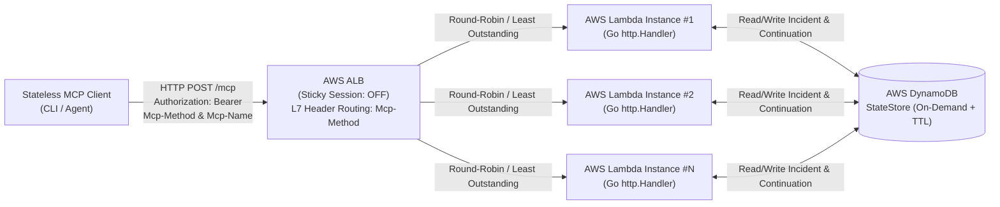

# MCP Incident Commander (`mcp-incident-commander`)

**FinOps & Cloud-Native Incident Commander**, yeni nesil **Stateless Model Context Protocol (`2026-07-28` spesifikasyonu)** standartlarını uygulayan, **AWS Application Load Balancer (ALB)** ve **AWS Lambda** üzerinde yatay ölçeklenebilir (ve ilerleyen aşamalarda kod değişikliği gerektirmeden Kubernetes/EKS üzerinde çalışabilir) örnek bir Go referans mimarisidir.

---

## 1. Projenin Amacı ve Çözülen Problem

Geleneksel MCP implementasyonları protokol seviyesinde durum bilgisi (stateful `initialize` el sıkışması ve `Mcp-Session-Id` oturumu) gerektirdiği için sunucusuz (Serverless) mimarilerde ve Sticky Session kapalı yük dengeleyiciler (ALB) arkasında yatay ölçeklenirken darboğaz yaratır.

`mcp-incident-commander`, **"Protokol Stateless, Uygulama Stateful"** prensibini kanıtlar:
- **Protokol Katmanı Tamamen Stateless (`2026-07-28`):** `initialize` el sıkışması ve `Mcp-Session-Id` kesinlikle yoktur. Her HTTP isteği kendi içinde bağımsızdır (`params._meta` içinde `protocolVersion: "2026-07-28"`, `clientInfo` ve `clientCapabilities` taşır).
- **L7 Yönlendirme (`SEP-2243`):** Her istekte `Mcp-Method` (`server/discover`, `tools/list`, `tools/call`) ve araç çağrılarında `Mcp-Name` HTTP başlığı zorunludur.
- **Araç Önbellekleme (`SEP-2549`):** `tools/list` yanıtları `ttlMs` ve `cacheScope` meta verileriyle istemci/gateway önbelleklemesini destekler.
- **Çok Turlu Onay Akışı (`SEP-2322`):** Yüksek maliyetli veya yüksek riskli altyapı müdahalelerinde bağlantı açık tutulmaz; durum DynamoDB'ye kaydedilerek `InputRequiredResult` (`continuation_token`) dönülür ve ikinci HTTP isteğiyle onay tamamlanır.
- **Streamable HTTP (Chunked SSE):** Uzun süren telemetri teşhisleri tek bir HTTP isteği süresi boyunca `text/event-stream` üzerinden aşamalı (%25, %50, %75, %100) akıtılır ve işlem bitince bağlantı kapatılır.

---

## 2. Üst Düzey Mimari



---

## 3. Dizin Yapısı

```text
mcp-incident-commander/
├── cmd/
│   ├── mcp-server/          # Çift modlu sunucu (AWS Lambda veya yerel HTTP sunucusu)
│   └── mcp-client/          # Stateless MCP CLI istemcisi
├── internal/
│   ├── mcp/                 # Stateless MCP 2026-07-28 protokol tipleri ve doğrulayıcıları
│   ├── middleware/          # SEP-2243 L7 Header ve Stateless JWT Auth middleware katmanı
│   ├── store/               # StateStore arayüzü, DynamoDB ve thread-safe InMemory adaptörleri
│   ├── tools/               # 3 MCP Aracı (Context Manager, Mitigation Plan, Live Telemetry)
│   └── server/              # http.Handler tabanlı Stateless MCP HTTP Router
├── pkg/
│   └── mcpclient/           # Tekrar kullanılabilir Stateless MCP Go Client SDK
├── deployments/
│   └── terraform/           # AWS ALB, Lambda (ARM64), DynamoDB ve IAM Terraform kodları
└── docs/
    ├── ARCHITECTURE.md      # Detaylı mimari, protokol akışları ve geliştirici rehberi
    └── RUNBOOK_SCALING.md   # Yatay ölçekleme ve operasyonel müdahale kılavuzu
```

---

## 4. Hızlı Başlangıç: Derleme ve Test

### Gereksinimler
- **Go:** `1.24` veya üzeri

### Komutlar

```bash
# Tüm paketleri derle
make build

# Yarış durumu (race detector) aktif olarak tüm unit testleri çalıştır
make test

# Statik kod analizi çalıştır
make vet
```

Detaylı protokol şemaları, geliştirme kuralları ve araç akışları için [docs/ARCHITECTURE.md](docs/ARCHITECTURE.md) dokümanını inceleyebilirsiniz.
