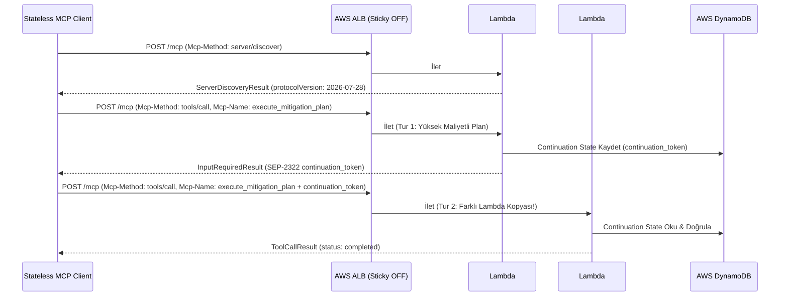

# Mimari ve Geliştirici Rehberi (`mcp-incident-commander`)

Bu doküman, `mcp-incident-commander` projesinin **Stateless MCP (`2026-07-28`)** protokol tasarımını, bileşen etkileşimlerini ve geliştirme standartlarını açıklar.

---

## 1. Stateless MCP `2026-07-28` Protokol Kuralları

Geleneksel MCP sürümlerinden farklı olarak `2026-07-28` spesifikasyonu sunucu belleğinde oturum tutulmasını yasaklar:

1. **`initialize` El Sıkışması Yoktur:** İstemci `initialize` veya `notifications/initialized` gönderirse sunucu `-32002` (`ErrCodeStatefulHandshakeForbidden`) hatası döner.
2. **`Mcp-Session-Id` Başlığı Yoktur:** HTTP katmanında oturum kimliği taşınmaz.
3. **Self-Contained `_meta` Alanı:** Her JSON-RPC 2.0 isteğinin `params._meta` nesnesi içinde aşağıdaki alanlar zorunludur:
   - `protocolVersion`: `"2026-07-28"`
   - `clientInfo`: `{"name": "<istemci-adı>", "version": "<sürüm>"}`
   - `clientCapabilities`: İstemcinin `multiRoundTrip` ve `streamableHttp` yetenekleri.
4. **Sunucu Keşfi (`server/discover`):** İstemciler sunucu yeteneklerini tek adımlık stateless `server/discover` çağrısıyla öğrenir.
5. **Araç Listesi Önbellekleme (`SEP-2549`):** `tools/list` yanıtı `ttlMs` ve `cacheScope` (`public`, `tenant`, `user`, `no-store`) alanlarını içerir.
6. **L7 Başlık Yönlendirmesi (`SEP-2243`):** Her HTTP isteğinde `Mcp-Method` başlığı, `tools/call` çağrılarında ise ek olarak `Mcp-Name` başlığı zorunludur ve JSON gövdesiyle birebir eşleşmelidir.

---

## 2. Geliştirme Standartları

- **Dil:** Go 1.24+
- **Kod ve Yorum Dili:** Değişken/fonksiyon isimleri, hata ve log mesajları İngilizce; kod içi yorumlar ve dokümantasyon Türkçe yazılır.
- **Taşınabilirlik (`http.Handler`):** Tüm iş mantığı standart `http.Handler` arayüzü üzerine inşa edilmiştir. Bu sayede aynı ikili dosya (binary) hem AWS Lambda (`aws-lambda-go-api-proxy`) üzerinde hem de yerel ortamda / Kubernetes (EKS) üzerinde doğrudan çalışır.
- **Test Disiplini:** Her paketteki değişiklikten sonra `go build ./...` ve `go test -v -race ./...` komutları hatasız geçmelidir.
