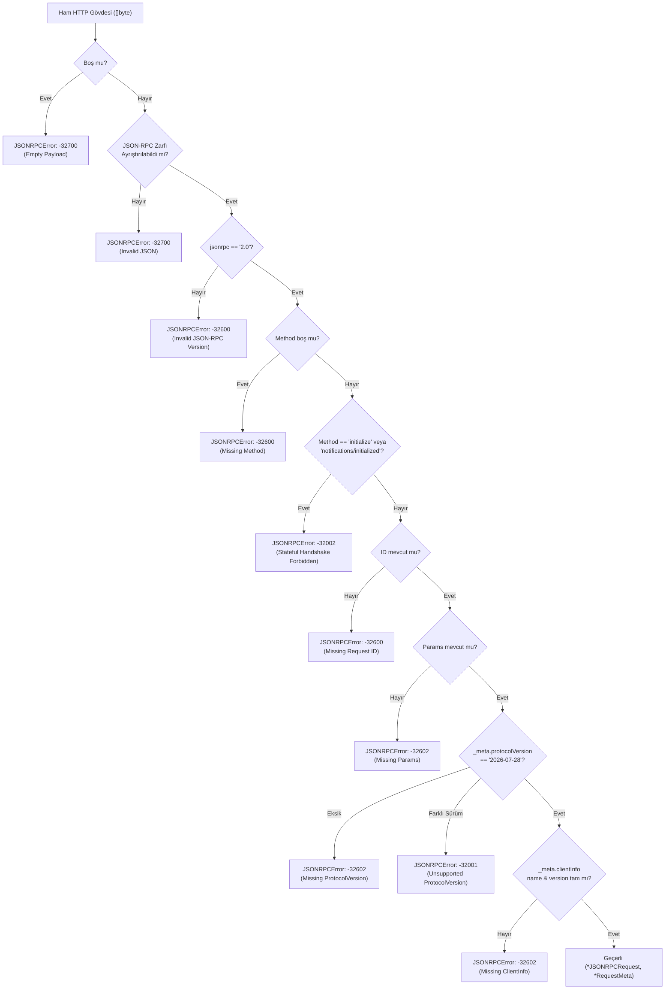

# Faz 1 / Step 1.1: Proje İskeleti ve Stateless MCP Protokol Tipleri — Muhakeme Günlüğü

Bu doküman, `mcp-incident-commander` projesinin **Faz 1 / Step 1.1 (`internal/mcp`)** adımında alınan mimari ve protokol düzeyi tasarım kararlarını, elenen alternatifleri, doğrulama kanıtlarını ve bilinçli olarak sonraki adımlara bırakılan noktaları kayıt altına alır. Amaç yalnızca hangi dosyaların üretildiğini listelemek değil, **Stateless MCP `2026-07-28`** spesifikasyonunun neden bu veri yapıları ve doğrulama kurallarıyla modellendiğini açıklamaktır.

---

## 0. Görevin kapsamı ve genel yaklaşım

- **Kapsam sınırı:** Kullanıcıdan gelen **"Başla"** onayından itibaren yalnızca **Faz 1 / Step 1.1** (`go.mod` kurulumu, Clean Architecture dizin iskeleti, `internal/mcp` protokol tipleri, `2026-07-28` zarf doğrulayıcısı ve unit testleri) uygulandı; çalışma protokolü gereği Step 1.2'ye geçmeden duruldu.
- **Hedef:** Sunucu belleğinde oturum tutmayan (`initialize` ve `Mcp-Session-Id` barındırmayan), her isteğin `params._meta` alanında kendi bağlamını taşıdığı Stateless MCP `2026-07-28` çekirdeğini, **SEP-2549** (`ttlMs`, `cacheScope`) ve **SEP-2322** (`InputRequiredResult`, `continuation_token`) standartlarıyla birlikte sıfır dış bağımlılıkla inşa etmek.
- **Genel strateji:**
  1. HTTP ve taşıma (transport) katmanına geçmeden önce protokol zarfını (`internal/mcp`) saf Go tipleri ve deterministik doğrulama fonksiyonları olarak izole etmek.
  2. Protokol ihlallerini (ör. legacy `initialize` çağrısı veya yanlış `protocolVersion`) erken dönüş (early return) prensibiyle ve standartlaştırılmış JSON-RPC 2.0 hata kodlarıyla yakalamak.
  3. Kod içi sihirli değerleri (magic string/number) tamamen sabitlere taşıyarak sonraki adımlarda (`internal/middleware`, `internal/tools`, `internal/server`, `pkg/mcpclient`) tek doğruluk kaynağı (Single Source of Truth) oluşturmak.

---

## 1. İlk inceleme

Kod yazmaya başlamadan önce çalışma dizinini ve derleyici ortamını doğruladım:

- **Çalışma dizini kontrolü (`ls -la`):** Dizinin tamamen boş (`total 0`) olduğunu doğruladım. Böylece mevcut bir kod tabanını veya `go.mod` dosyasını ezme riski olmadığını netleştirdim.
- **Go sürümü kontrolü (`go version`):** Sistemde `go version go1.26.4 darwin/arm64` kurulu olduğunu doğruladım. Bu sürüm, hedeflediğimiz Go 1.24+ standart kütüphane yeteneklerini fazlasıyla karşılıyor.
- **Git durumu kontrolü (`git status`):** Çalışma dizininde henüz `.git` deposunun başlatılmadığını (`fatal: not a git repository`) tespit ettim. Bu nedenle her adım sonunda önerilen Conventional Commits mesajını kullanıcıya sunma kuralını uyguladım.
- **Mimari kısıtların incelenmesi:**
  - Uzak bir GitHub/GitLab yolu yerine yerel modül adı kullanılması kuralı gereği modülü `go mod init mcp-incident-commander` komutuyla başlattım.
  - Protokolde `initialize` ve `Mcp-Session-Id` kesinlikle yasak olduğu için, bu değerlerin sadece "desteklenmemesi" değil, aktif olarak tespit edilip reddedilmesi gerektiğine karar verdim.

---

## 2. Mimari kararlar

### 2.1 JSON-RPC 2.0 `params` alanının ayrıştırma stratejisi (`json.RawMessage` vs. `map[string]any` vs. Generic Zarf)

- **Karar:** `JSONRPCRequest.Params` ve `ToolCallParams.Arguments` alanlarını `json.RawMessage` olarak tanımlayıp iki aşamalı (two-phase) ayrıştırma uyguladım (`internal/mcp/types.go`, `internal/mcp/validator.go`).
- **Değerlendirdiğim alternatifler:**
  - **(A) `Params any` veya `map[string]any` kullanmak:** İlk `json.Unmarshal` çağrısında tüm iç nesneyi `map[string]any` olarak çözmek.
  - **(B) Generic `JSONRPCRequest[T any]` kullanmak:** Her metod için ayrı zarf tipi tanımlamak.
  - **(C) `Params json.RawMessage` ile ertelenmiş (lazy/two-stage) ayrıştırma kullanmak:** İlk aşamada zarfı ve ortak `BaseParams` (`_meta`) yapısını doğrulamak, ardından metoda özgü (`ToolCallParams`, `ToolsListParams` vb.) yapıya unmarshal etmek.
- **Seçim ve gerekçe:** **(C)** seçildi.
  - Alternatif (A) seçilseydi, `tools/call` içindeki araca özgü argümanları tekrar tipli Go struct'larına dönüştürmek için ya `mapstructure` gibi ek kütüphaneler gerekecek ya da `json.Marshal` + `json.Unmarshal` yapılarak gereksiz CPU/bellek tahsisi (allocation) oluşacaktı.
  - Alternatif (B) ise HTTP router katmanında gelen isteğin `method` alanı okunmadan önce hangi generic tipin kullanılacağı bilinemeyeceği için çift JSON parse maliyeti doğuracaktı.
  - `json.RawMessage` sayesinde `ParseAndValidateRequest` fonksiyonu ham JSON'u tek seferde zarfa ayırıyor, `BaseParams` üzerinden `params._meta` doğrulamasını yapıyor ve ham `Params` dilimini alt katmanlara (`ParseToolCallParams`) sıfır kopya maliyetiyle devrediyor.

### 2.2 Legacy Stateful el sıkışmasının (`initialize`) ele alınış biçimi

- **Karar:** `initialize` ve `notifications/initialized` metodlarını genel "metod bulunamadı" (`-32601`) hatasına düşürmek yerine, özel bir protokol hata kodu (`ErrCodeStatefulHandshakeForbidden = -32002`) ve açıklayıcı bir hata mesajıyla reddettim.
- **Değerlendirdiğim alternatifler:**
  - **(A) `MethodNotFound (-32601)` dönmek:** Tanınmayan her metod gibi ele almak.
  - **(B) Sessizce sahte bir `initialize` yanıtı dönmek:** Eski MCP istemcileriyle geriye dönük uyumluluk sağlamak.
  - **(C) Özel `-32002` (`ErrCodeStatefulHandshakeForbidden`) hatası ile açıkça reddetmek:** İstemciye sunucunun Stateless MCP `2026-07-28` çalıştığını ve `params._meta` veya `server/discover` kullanması gerektiğini bildirmek.
- **Seçim ve gerekçe:** **(C)** seçildi.
  - Alternatif (B) mimari kriter 1'i ("Protokol seviyesinde `initialize` el sıkışması KESİNLİKLE YOKTUR") doğrudan ihlal ederdi.
  - Alternatif (A) ise yanlış yapılandırılmış bir istemcinin sorunun "yanlış URL/endpoint" mi yoksa "stateful vs stateless protokol uyumsuzluğu" mu olduğunu anlamasını zorlaştırırdı. Özel hata kodu (`-32002`) ve yönlendirici hata mesajı, hem hata ayıklamayı hızlandırır hem de protokol sözleşmesini deterministik olarak kanıtlar.

### 2.3 SEP-2322 Multi-Round-Trip (`InputRequiredResult`) veri modelinin `ToolCallResult` içine yerleştirilmesi

- **Karar:** `ToolCallResult` yapısını hem tamamlanmış çıktıları (`Status: "completed"`, `Content: []ContentBlock`) hem de SEP-2322 onay/ek girdi taleplerini (`Status: "input_required"`, `InputRequired: *InputRequiredResult`) tek bir birleşik şemada taşıyacak şekilde tasarladım.
- **Değerlendirdiğim alternatifler:**
  - **(A) Onay gerektiğinde JSON-RPC `error` alanı içinde `continuation_token` dönmek:** İşlemi hata gibi işaretlemek.
  - **(B) `ToolCallResult.Result` alanını `any` olarak bırakıp çalışma zamanında farklı struct'lar dönmek:** Tip güvenliğinden vazgeçmek.
  - **(C) `ToolCallResult` içinde açık `Status` ayrımı (`completed` / `input_required`) ve tipli `*InputRequiredResult` alanı kullanmak:** Hem sunucu hem istemci SDK (`pkg/mcpclient`) için derleme zamanı tip güvenliği sağlamak.
- **Seçim ve gerekçe:** **(C)** seçildi.
  - SEP-2322'de yüksek maliyetli bir işlemin onay istemesi bir hata değil, geçerli bir durum geçişidir (state transition); bu yüzden Alternatif (A) semantik olarak yanlıştır.
  - Alternatif (C) sayesinde Step 2.2'de yazacağımız `execute_mitigation_plan` aracı `NewInputRequiredToolResult` yardımcı fonksiyonunu çağırarak tip güvenli bir yanıt üretebilecek, Step 3.2'deki Go Client SDK ise `result.Status == mcp.StatusInputRequired` kontrolüyle ikinci tur isteği doğrudan tetikleyebilecektir.

### 2.4 Paket ve bağımlılık izolasyonu

- **Karar:** Step 1.1'de `internal/mcp` paketini yalnızca Go standart kütüphanesi (`encoding/json`, `errors`, `fmt`, `strings`) ile yazdım; AWS SDK ve JWT bağımlılıklarını henüz `go.mod`'a eklemedim.
- **Değerlendirdiğim alternatifler:**
  - **(A) Tüm proje bağımlılıklarını (`aws-sdk-go-v2`, `aws-lambda-go`, `golang-jwt`) Step 1.1'de peşinen `go.mod`'a indirmek.**
  - **(B) Her bağımlılığı ilk kullanıldığı adımda (JWT -> Step 1.2, DynamoDB -> Step 2.1, Lambda Proxy -> Step 3.1) eklemek.**
- **Seçim ve gerekçe:** **(B)** seçildi.
  - `internal/mcp` çekirdek protokol paketinin hiçbir bulut sağlayıcısına (AWS) veya kimlik doğrulama kütüphanesine bağımlı olmaması Clean Architecture açısından kritiktir. Ayrıca kullanılmayan bağımlılıkları `go.mod` içinde tutmak `go mod tidy` tarafından temizleneceği için her paketin kendi adımında bağımlılığını getirmesi daha temiz ve izlenebilir bir bağımlılık grafiği sağlar.

---

## 3. Stateless MCP `2026-07-28` zarf doğrulama ve veri modeli akışı

`internal/mcp/validator.go` içinde uygulanan `ParseAndValidateRequest` fonksiyonu, iç içe `if` blokları yerine erken dönüş (early return) zinciriyle aşağıdaki karar ağacını işletir:



---

## 4. Test / doğrulama stratejisi

Step 1.1 kapsamında `internal/mcp/mcp_test.go` dosyasında tüm testler `t.Parallel()` ile eşzamanlı koşturulacak şekilde 5 doğrulama boyutunda kurgulandı:

1. **Mutlu Yol (Happy Path) Zarf ve `_meta` Doğrulaması (`TestParseAndValidateRequest_Success`):**
   - `protocolVersion: "2026-07-28"`, `clientInfo` ve `clientCapabilities` (`multiRoundTrip: true`, `streamableHttp: true`) içeren geçerli bir `server/discover` isteğinin hatasız ayrıştırıldığını kanıtlar.
2. **Tablo Güdümlü (Table-Driven) Sınır ve Hata Senaryoları (`TestParseAndValidateRequest_ValidationErrors`):**
   - 12 ayrı alt senaryo (`empty_payload`, `malformed_json`, `invalid_jsonrpc_version`, `missing_method`, `forbidden_initialize_handshake`, `forbidden_initialized_notification`, `missing_request_id`, `missing_params`, `missing_protocolVersion_in__meta`, `unsupported_legacy_protocolVersion`, `missing_clientInfo_name`, `missing_clientInfo_version`) ile her hata kodunun (`-32700`, `-32600`, `-32602`, `-32001`, `-32002`) ve hata metninin birebir eşleştiğini kanıtlar.
3. **Araç Çağrısı ve Devam Jetonu Ayrıştırması (`TestParseToolCallParams_SuccessAndContinuation`):**
   - `tools/call` içinde SEP-2322 `continuation_token` alanının ve eksik araç adı (`missing tool name`) hata durumunun doğru çalıştığını kanıtlar.
4. **SEP-2549 Önbellek Doğrulaması (`TestSEP2549ToolsListValidationAndSerialization`):**
   - `ToolsListResult` serileştirmesinde `"ttlMs":300000` ve `"cacheScope":"tenant"` alanlarının üretildiğini, negatif `ttlMs` (`ErrNegativeTTL`) ve tanımsız `cacheScope` (`ErrInvalidCacheScope`) değerlerinin reddedildiğini kanıtlar.
5. **SEP-2322 Çok Turlu Onay Doğrulaması (`TestSEP2322InputRequiredValidationAndSerialization`):**
   - `NewInputRequiredToolResult` ve `ValidateInputRequiredResult` fonksiyonlarının `continuation_token` ve `reason` zorunluluğunu (`ErrMissingContinuationToken`, `ErrMissingInputReason`) denetlediğini kanıtlar.

**Çalıştırılan doğrulama komutu ve çıktısı:**
```text
$ go vet ./... && go build ./... && go test -v -race ./...
=== RUN   TestParseAndValidateRequest_Success
--- PASS: TestParseAndValidateRequest_Success (0.00s)
=== RUN   TestParseAndValidateRequest_ValidationErrors
--- PASS: TestParseAndValidateRequest_ValidationErrors (0.00s)
    [12/12 alt test senaryosu PASS]
=== RUN   TestParseToolCallParams_SuccessAndContinuation
--- PASS: TestParseToolCallParams_SuccessAndContinuation (0.00s)
=== RUN   TestServerDiscoverySerialization
--- PASS: TestServerDiscoverySerialization (0.00s)
=== RUN   TestSEP2549ToolsListValidationAndSerialization
--- PASS: TestSEP2549ToolsListValidationAndSerialization (0.00s)
=== RUN   TestSEP2322InputRequiredValidationAndSerialization
--- PASS: TestSEP2322InputRequiredValidationAndSerialization (0.00s)
=== RUN   TestNewTextToolResultAndErrorResponse
--- PASS: TestNewTextToolResultAndErrorResponse (0.00s)
PASS
ok  	mcp-incident-commander/internal/mcp	1.339s
```

---

## 5. Doğrulamada çıkan durumlar ve gözlemler

- Kod derleme (`go build ./...`), statik analiz (`go vet ./...`) ve yarış durumu tespitli test (`go test -v -race ./...`) aşamalarında herhangi bir derleme veya çalışma zamanı hatası çıkmadı.
- **Gözlem (`JSONRPCRequest.ID` kontrolü):** JSON-RPC 2.0 spesifikasyonunda `id` alanı hem `string` hem de sayı (`float64`/`int`) olabildiği için `ID any` olarak tanımlandı. Doğrulama sırasında yalnızca `req.ID == nil` kontrolü yapmak yerine, istemcinin `"id": ""` (boş string) göndermesi ihtimaline karşı `req.ID == nil || req.ID == ""` kontrolünü birlikte uyguladım.

---

## 6. Commit stratejisi

Çalışma dizininde henüz bir Git deposu başlatılmadığı için doğrudan `git commit` çalıştırılmadı; ancak her adımın kendi başına derlenebilir ve geri alınabilir (atomic) bir birim oluşturması kuralı gereği Step 1.1 aşağıdaki Conventional Commit mesajıyla paketlendi:

- `feat(mcp): implement stateless MCP 2026-07-28 protocol types, SEP-2549 caching, and SEP-2322 models`

---

## 7. Bilinçli olarak ertelenenler / açık noktalar

Step-by-step ilerleme kuralı gereği aşağıdaki bileşenler bilinçli olarak kendi adımlarına bırakılmıştır:

1. **HTTP Başlık (`Mcp-Method`, `Mcp-Name`, `Mcp-Session-Id`) ve Gövde Uyum Doğrulaması:** Sabitleri `internal/mcp/types.go` içinde tanımlandı ancak HTTP middleware kontrolü **Faz 1 / Step 1.2**'de (`internal/middleware/headers.go`) uygulanacak.
2. **Stateless JWT Doğrulaması (`TenantID`, `EngineerID`):** **Faz 1 / Step 1.2**'de (`internal/middleware/auth.go`) uygulanacak.
3. **DynamoDB ve InMemory `StateStore` Katmanı:** **Faz 2 / Step 2.1**'de (`internal/store`) uygulanacak.
4. **3 MCP Aracının İş Mantığı ve SSE Stream Akışı:** **Faz 2 / Step 2.1, 2.2 ve 2.3**'te (`internal/tools`) uygulanacak.
5. **Çift Modlu Sunucu (Lambda + HTTP) ve Go Client SDK:** **Faz 3 / Step 3.1 ve 3.2**'de uygulanacak.
6. **Terraform Altyapısı ve Ölçekleme Runbook'u:** **Faz 4 / Step 4.1 ve 4.2**'de uygulanacak.

---

## 8. Kısa özet

| Karar | Seçim | Ana gerekçe |
| :--- | :--- | :--- |
| Go modül isimlendirmesi | `module mcp-incident-commander` | Uzak repo yerine yerel/bağıl isimlendirme kuralına tam uyum. |
| `Params` ve `Arguments` tipi | `json.RawMessage` (iki aşamalı ayrıştırma) | Zarf ve `_meta` doğrulamasını araca özgü şemalardan ayırırken çift serileştirme maliyetinden kaçınmak. |
| `initialize` metoduna yaklaşım | Özel hata kodu `-32002` (`ErrCodeStatefulHandshakeForbidden`) | Stateless `2026-07-28` kuralını açıkça uygulamak ve istemciyi `params._meta` / `server/discover` kullanımına yönlendirmek. |
| SEP-2322 yanıt modellemesi | `ToolCallResult` içinde tipli `*InputRequiredResult` ve `Status` alanı | Çok turlu onay akışını hata olarak değil, derleme zamanı tip güvenli bir durum geçişi olarak modellemek. |
| Paket bağımlılıkları | Yalnızca Go standart kütüphanesi | Çekirdek protokol katmanını (`internal/mcp`) bulut ve taşıma katmanlarından tamamen bağımsız tutmak. |
