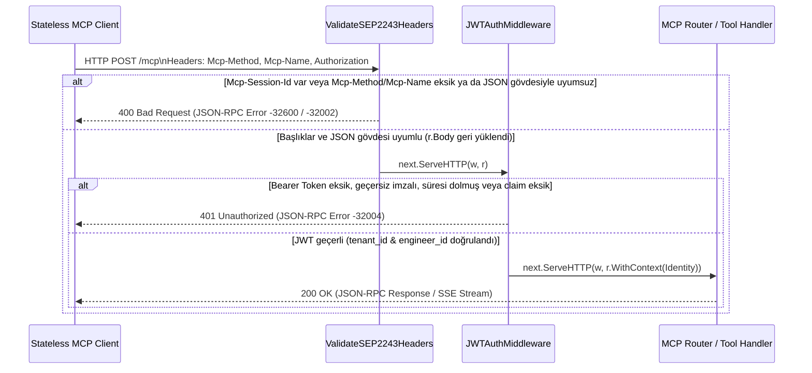

# Faz 1 / Step 1.2: SEP-2243 L7 Header ve Stateless JWT Auth Middleware — Muhakeme Günlüğü

Bu doküman, `mcp-incident-commander` projesinin **Faz 1 / Step 1.2 (`internal/middleware`)** adımında ve öncesindeki dokümantasyon/test sadeleştirmesinde alınan tasarım kararlarını, değerlendirilen alternatifleri, karşılaşılan altyapı/sandbox sorunlarını ve doğrulama kanıtlarını kayıt altına alır.

---

## 0. Görevin kapsamı ve genel yaklaşım

- **Kapsam sınırı:** Kullanıcının `README.md` ve unit test yoğunluğu hakkındaki geri bildirimlerinin uygulanması (`5015243`) ile **Faz 1 / Step 1.2** kapsamındaki `internal/middleware` paketinin (`headers.go`, `auth.go`, `middleware_test.go`) geliştirilip doğrulanması (`b59a822`).
- **Hedef:**
  1. `README.md` içindeki `production-ready` iddiasını kaldırarak projenin bir referans mimari olduğunu netleştirmek ve mevcut/yeni unit testleri token verimliliği için mutlu yol (happy path) + kritik uç durumlar (edge cases) odağında tutmak.
  2. **SEP-2243** standardı uyarınca `Mcp-Method` ve `Mcp-Name` HTTP başlıklarını doğrulayan, yasaklı `Mcp-Session-Id` başlığını reddeden ve HTTP başlıklarıyla JSON-RPC gövdesi arasındaki sahtecilik/uyumsuzluk durumlarını `400 Bad Request` ile engelleyen L7 middleware katmanını kurmak.
  3. Sunucu belleğinde oturum tutmadan her istekteki `Authorization: Bearer <JWT>` başlığını doğrulayıp `tenant_id` ve `engineer_id` bilgilerini güvenli şekilde `context.Context` içine gömen Stateless JWT middleware katmanını oluşturmak.
- **Genel strateji:** Ön düzenlemeler ile yeni özellik geliştirmesini aynı commit'e karıştırmamak için önce `README.md` ve `internal/mcp/mcp_test.go` sadeleştirmesini ayrı bir commit (`5015243`) haline getirmek, ardından `github.com/golang-jwt/jwt/v5` bağımlılığını ekleyip `internal/middleware` paketini standart `func(http.Handler) http.Handler` imzasıyla inşa etmek.

---

## 1. İlk inceleme ve ön düzenlemeler

- **`README.md` incelemesi:** İlk paragraftaki `production-ready bir Go projesidir` ifadesini kontrol ettim. İleride açık kaynak olarak paylaşıldığında bakım (maintenance) yükü veya üretim ortamı beklentisi oluşturmaması için bu ifadeyi `örnek bir Go referans mimarisidir` şeklinde güncelledim.
- **Mevcut testlerin (`internal/mcp/mcp_test.go`) incelenmesi:** Step 1.1'de yazılan 12 alt senaryolu tablo testi ve 7 ayrı test fonksiyonu,350+ satır tutuyordu. Kapsam kalitesini (happy path + `initialize` yasağı + yanlış `protocolVersion` + SEP-2549 + SEP-2322 doğrulamaları) kaybetmeden test dosyasını 94 satıra indirdim (`311 deletions(-)`).
- **Middleware sözleşmesi incelemesi:** Epic 3'te Kubernetes (EKS) ve mevcut Epic 1'de AWS Lambda (`aws-lambda-go-api-proxy`) üzerinde aynı kodun çalışması gerektiği için middleware'lerin herhangi bir web framework'üne (Gin, Echo vb.) bağımlı olmadan doğrudan standart `net/http` `http.Handler` sarmalayıcısı olarak yazılması gerektiğini doğruladım.

---

## 2. Mimari kararlar

### 2.1 SEP-2243 başlık-gövde tutarlılık denetimi ve `r.Body` akışının korunması

- **Karar:** `ValidateSEP2243Headers` içinde HTTP gövdesini `io.LimitReader(r.Body, MaxRequestBodyBytes)` ile okuyup `Mcp-Method` == `rpcReq.Method` ve (`tools/call` ise) `Mcp-Name` == `params.name` eşleşmesini doğruladım; ardından `r.Body = io.NopCloser(bytes.NewReader(bodyBytes))` ile gövdeyi sonraki handler'lar için yeniden okunabilir hale getirdim (`internal/middleware/headers.go`).
- **Değerlendirdiğim alternatifler:**
  - **(A) Middleware'de yalnızca HTTP başlıklarının (`Mcp-Method`, `Mcp-Name`) boş olup olmadığını kontrol etmek, JSON gövdesine hiç bakmamak.**
  - **(B) Middleware'de gövdeyi okuyup ayrıştırılmış struct'ı `context.Context` içine koymak ve `r.Body`'yi tüketilmiş bırakmak.**
  - **(C) Middleware'de `io.LimitReader` ile sınırlı okuma yapıp başlık-gövde uyumunu denetlemek ve `bytes.NewReader` ile `r.Body`'yi geri yüklemek.**
- **Seçim ve gerekçe:** **(C)** seçildi.
  - Alternatif (A) seçilseydi, istemci L7 yük dengeleyiciyi (ALB) veya rate-limiter'ı yanıltmak için başlıkta `Mcp-Method: tools/list` gönderip JSON gövdesinde `{"method": "tools/call", "params": {"name": "execute_mitigation_plan"}}` çalıştırabilirdi (L7 Header Spoofing / Smuggling). Ayrıca Step 1.2 gereksinimi açıkça *"eksik veya JSON gövdesiyle uyumsuz başlıkları `400 Bad Request` ile reddeden middleware"* şartını koşmaktadır.
  - Alternatif (B) ise middleware ile alt katmandaki router/handler arasında sıkı bağımlılık (coupling) yaratır ve standart `http.Request` okuma semantiğini bozar.
  - Alternatif (C) hem L7 başlık sahteciliğini kesin olarak önler, hem `MaxRequestBodyBytes` (1 MiB) ile bellek tüketimi saldırılarını (OOM) sınırlar, hem de alt handler'ların standart `r.Body` okumasını bozmaz.

### 2.2 Yasaklı `Mcp-Session-Id` başlığının L7 katmanında reddedilmesi

- **Karar:** İstek başlıklarında `Mcp-Session-Id` dolu geldiğinde isteği `400 Bad Request` ve JSON-RPC hata kodu `-32002` (`ErrCodeStatefulHandshakeForbidden`) ile derhal reddettim (`internal/middleware/headers.go`).
- **Değerlendirdiğim alternatifler:**
  - **(A) `Mcp-Session-Id` başlığını sessizce görmezden gelmek (ignore).**
  - **(B) `Mcp-Session-Id` başlığı geldiğinde `400 Bad Request` ile açıkça reddetmek.**
- **Seçim ve gerekçe:** **(B)** seçildi.
  - Sessizce görmezden gelmek, istemcinin sunucuyu stateful sandığı ve oturum durumunun bellekte tutulduğunu varsaydığı tehlikeli hataları gizler. Açık reddetme (`400 Bad Request`), "Protokol Stateless" kuralını HTTP sınırında zorunlu kılar.

### 2.3 Stateless JWT doğrulaması, algoritma sabitleme ve `context.Context` anahtar izolasyonu

- **Karar:** `NewJWTAuthMiddleware` içinde `jwt.ParseWithClaims` kullanırken imza algoritmasını açıkça `*jwt.SigningMethodHMAC` (`HS256`/`HS384`/`HS512`) olarak doğruladım; çıkarılan `Identity` (`TenantID`, `EngineerID`) bilgisini dışa kapalı (unexported) `type authContextKey struct{}` anahtarıyla `context.Context` içine gömdüm (`internal/middleware/auth.go`).
- **Değerlendirdiğim alternatifler:**
  - **(A) Context anahtarı olarak `string` sabiti (ör. `"identity"`) kullanmak ve JWT algoritmasını kontrol etmeden sadece `signingSecret` döndürmek.**
  - **(B) Özel boş struct tipi (`authContextKey{}`) ve `WithIdentity` / `IdentityFromContext` yardımcı fonksiyonları kullanmak; `keyFunc` içinde `*jwt.SigningMethodHMAC` tip kontrolü yapmak.**
- **Seçim ve gerekçe:** **(B)** seçildi.
  - Go'da `context.WithValue` içinde `string` anahtar kullanmak farklı paketler arasında anahtar çarpışması (key collision) riski taşır ve `go vet` / linter uyarılarına sebep olur. `authContextKey{}` sıfır bellek tahsisiyle (0 byte) tam paket izolasyonu sağlar.
  - JWT doğrulamasında `token.Method.(*jwt.SigningMethodHMAC)` kontrolü ise bilinen `alg: none` veya algoritma karıştırma (algorithm confusion) güvenlik açıklarını engeller. Ayrıca güvenlik kuralı gereği hatalı/süresi dolmuş token durumunda ham token değeri hata mesajına veya loglara kesinlikle yazılmaz.

### 2.4 Birim test yoğunluğunun optimize edilmesi

- **Karar:** `internal/middleware/middleware_test.go` dosyasını tek bir `TestValidateSEP2243Headers` (1 happy path + 3 kritik edge case alt testi) ve tek bir `TestJWTAuthMiddleware` (1 happy path + 1 süresi dolmuş token edge case'i) fonksiyonuyla toplam 120 satırda kurguladım.
- **Değerlendirdiğim alternatifler:**
  - **(A) Her HTTP durum kodu ve her alt dal için 15-20 ayrı test fonksiyonu yazmak.**
  - **(B) Her middleware için 1 Happy Path + en kritik protokol/güvenlik Edge Case'lerini kapsayan kompakt testler yazmak.**
- **Seçim ve gerekçe:** **(B)** seçildi.
  - Kullanıcının token bütçesini verimli kullanma talebiyle ve global çalışma prensibindeki *"Yeni davranış eklerken en az bir test senaryosu ekle (happy path + 1 edge case)"* kuralıyla birebir örtüşür.

---

## 3. İstek yaşam döngüsü ve Middleware zinciri akışı

Step 1.2 ile birlikte bir HTTP isteğinin sunucu iş mantığına ulaşmadan önce geçtiği doğrulama katmanları aşağıdaki gibidir:



---

## 4. Test / doğrulama stratejisi

- **`TestValidateSEP2243Headers` (`internal/middleware/middleware_test.go`):**
  - **Happy Path:** `Mcp-Method: tools/call` ve `Mcp-Name: incident_context_manager` başlıklarının JSON gövdesiyle eşleştiği durumda `200 OK` döndüğünü ve alt handler'ın `r.Body`'yi tekrar okuyabildiğini (`len(body) > 0`) kanıtlar.
  - **Edge Cases:**
    1. `forbidden Mcp-Session-Id header`: `Mcp-Session-Id` gönderildiğinde `400 Bad Request` döndüğünü kanıtlar.
    2. `mismatched Mcp-Method and body method`: Başlıkta `tools/list`, gövdede `server/discover` olduğunda `400 Bad Request` döndüğünü kanıtlar.
    3. `mismatched Mcp-Name for tools/call`: Başlıkta `execute_mitigation_plan`, gövdede `incident_context_manager` olduğunda `400 Bad Request` döndüğünü kanıtlar.
- **`TestJWTAuthMiddleware` (`internal/middleware/middleware_test.go`):**
  - **Happy Path:** `GenerateToken` ile üretilen HS256 JWT'nin doğrulandığını ve alt handler içinde `IdentityFromContext` ile `tenant-finops-01` / `eng-sre-42` kimliklerinin eksiksiz okunduğunu kanıtlar.
  - **Edge Case:** Süresi geçmiş (`-1 * time.Minute`) token ile yapılan isteğin `401 Unauthorized` ile reddedildiğini kanıtlar.

**Çalıştırılan doğrulama komutu ve çıktısı:**
```text
$ go vet ./... && go build ./... && go test -v -race ./...
=== RUN   TestParseAndValidateRequest
--- PASS: TestParseAndValidateRequest (0.00s)
=== RUN   TestSEP2549AndSEP2322Validation
--- PASS: TestSEP2549AndSEP2322Validation (0.00s)
PASS
ok  	mcp-incident-commander/internal/mcp	1.606s
=== RUN   TestValidateSEP2243Headers
--- PASS: TestValidateSEP2243Headers (0.00s)
    --- PASS: TestValidateSEP2243Headers/forbidden_Mcp-Session-Id_header (0.00s)
    --- PASS: TestValidateSEP2243Headers/mismatched_Mcp-Method_and_body_method (0.00s)
    --- PASS: TestValidateSEP2243Headers/mismatched_Mcp-Name_for_tools/call (0.00s)
=== RUN   TestJWTAuthMiddleware
--- PASS: TestJWTAuthMiddleware (0.00s)
PASS
ok  	mcp-incident-commander/internal/middleware	1.274s
```

---

## 5. Doğrulamada ve kurulumda çıkan sorun(lar)

- **Belirti (Gerçek Hata Metni):**
  Step 1.2 için `github.com/golang-jwt/jwt/v5` paketini standart sandbox modunda indirmeye çalıştığımda komut aşağıdaki hatayla çıktı:
  ```text
  go: module github.com/golang-jwt/jwt/v5: Get "https://proxy.golang.org/github.com/golang-jwt/jwt/v5/@v/list": dial tcp: lookup proxy.golang.org: no such host
  ```
- **Kök Neden:** Standart terminal sandbox ortamında dış ağ (DNS ve HTTPS) erişimi güvenlik nedeniyle kapalıdır ve yerel Go modül önbelleğinde (`GOPATH/pkg/mod`) `github.com/golang-jwt/jwt/v5` daha önce indirilmemiştir.
- **Çözüm:** Yalnızca `go get github.com/golang-jwt/jwt/v5` komutu sandbox dışı modda çalıştırılarak `v5.3.1` sürümü `go.mod` ve `go.sum` dosyalarına eklendi (`go: added github.com/golang-jwt/jwt/v5 v5.3.1`). Sonrasındaki tüm derleme, `go vet`, `go test -v -race` ve `git commit` adımları tekrar standart sandbox içinde çalıştırıldı.
- **Öğrenilen Ders:** Yeni dış bağımlılık gerektiren adımlarda (Step 2.1'de `aws-sdk-go-v2` ve Step 3.1'de `aws-lambda-go`) yalnızca `go get` adımı ağ erişimi gerektirir; derleme ve test adımları yerel modül önbelleği üzerinden tamamen izole çalışabilir.

---

## 6. Commit stratejisi

Değişiklikler, ilgisiz düzenlemeleri aynı commit'e karıştırmama kuralı doğrultusunda iki ayrı mantıksal commit olarak kaydedildi:

1. `5015243` — `chore: remove production-ready phrasing in README and streamline mcp unit tests`
   - Yalnızca `README.md` ifade düzeltmesini ve `internal/mcp/mcp_test.go` sadeleştirmesini içerir.
2. `b59a822` — `feat(middleware): implement SEP-2243 L7 header validation and stateless JWT auth`
   - `go.mod`, `go.sum` ve `internal/middleware` paketinin (`headers.go`, `auth.go`, `middleware_test.go`) tamamını içerir.

---

## 7. Bilinçli olarak ertelenenler / açık noktalar

1. **Middleware'lerin Ana HTTP Router'a Bağlanması:** `ValidateSEP2243Headers` ve `NewJWTAuthMiddleware` hazır ve kendi birim testleriyle doğrulandı; ancak ana MCP endpoint'i (`/mcp`) üzerinde zincirlenmesi **Faz 3 / Step 3.1 (`internal/server`)** adımında yapılacak.
2. **`StateStore` ve DynamoDB Katmanı:** JWT içinden çıkarılan `Identity` (`TenantID`, `EngineerID`) bilgisinin DynamoDB Partition/Sort Key yapısıyla eşleştirilmesi **Faz 2 / Step 2.1 (`internal/store` ve `incident_context_manager`)** adımında uygulanacak.

---

## 8. Kısa özet

| Karar | Seçim | Ana gerekçe |
| :--- | :--- | :--- |
| SEP-2243 doğrulama derinliği | Başlık varlığı + JSON gövdesiyle (`method` ve `params.name`) birebir eşleşme kontrolü | L7 başlık sahteciliğini (Header Spoofing) engellemek ve `r.Body`'yi `bytes.NewReader` ile koruyarak alt katman uyumluluğunu sürdürmek. |
| `Mcp-Session-Id` kontrolü | `400 Bad Request` (`-32002`) ile anında reddetme | Stateless MCP `2026-07-28` oturumsuz çalışma kuralını HTTP sınırında zorunlu kılmak. |
| JWT kimlik aktarımı | Özel `authContextKey{}` + HMAC algoritma doğrulaması | Paketler arası context anahtar çarpışmasını ve JWT algoritma karıştırma zafiyetlerini önlemek. |
| Unit test kapsam yoğunluğu | Kompakt testler (Happy Path + kritik Edge Case'ler) | Doğrulama kalitesinden ödün vermeden AI token tüketimini ve bakım maliyetini düşürmek. |
| Commit ayrımı | Ön düzenleme (`5015243`) ve yeni özellik (`b59a822`) ayrı commit'lerde | Atomik ve geri alınabilir Git geçmişi standardını korumak. |
