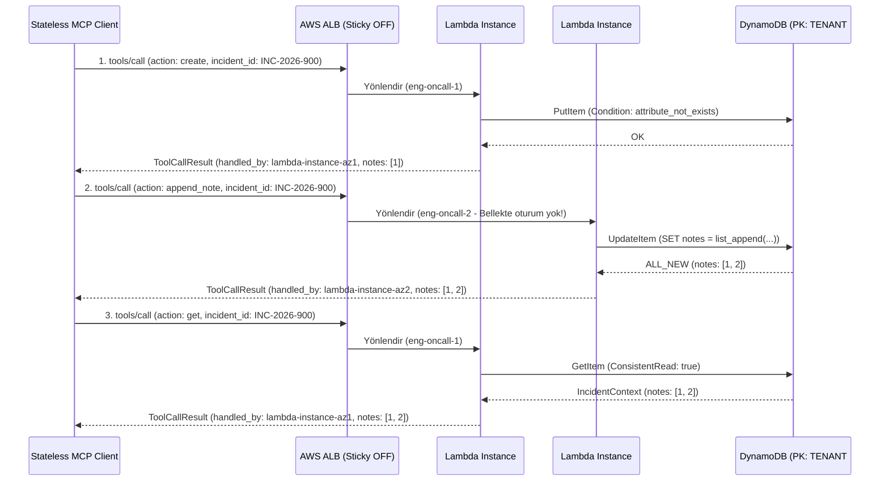

# Faz 2 / Step 2.1: StateStore Arayüzü, DynamoDB Adaptörü ve Tool 1 (`incident_context_manager`) — Muhakeme Günlüğü

Bu doküman, `mcp-incident-commander` projesinin **Faz 2 / Step 2.1 (`internal/store` ve `internal/tools/incident_context.go`)** adımında alınan veri modelleme, eşzamanlılık (concurrency), çok kiracılı izolasyon (multi-tenant isolation) ve hata sınıflandırma kararlarını; değerlendirilen alternatifleri ve doğrulama kanıtlarını kayıt altına alır.

---

## 0. Görevin kapsamı ve genel yaklaşım

- **Kapsam sınırı:** **Faz 2 / Step 2.1** kapsamında uygulama durumu soyutlaması (`internal/store/store.go`), gerçek AWS DynamoDB adaptörü (`internal/store/dynamodb.go`), yerel/test ortamı için thread-safe bellek içi adaptör (`internal/store/memory.go`), 1. MCP aracı olan `incident_context_manager` (`internal/tools/incident_context.go`) ve bunların birim testleri (`store_test.go`, `tools_test.go`) geliştirildi (`fe1b52f`).
- **Hedef:** "Protokol Stateless, Uygulama Stateful" mimari kriterini kanıtlamak; yani Sticky Session kapalı bir AWS ALB arkasında çalışan birbirinden habersiz Lambda kopyalarının, istemcinin Bearer JWT'sindeki `tenant_id` ve `engineer_id` bağlamını kullanarak aynı olay (incident) durumunu yarış durumuna (race condition) girmeden okuyup yazabilmesini sağlamak.
- **Genel strateji:**
  1. Hem Step 2.1 (`IncidentContext`) hem de Step 2.2 (`MitigationContinuation` - SEP-2322) gereksinimlerini tek bir `StateStore` sözleşmesinde ve tek bir DynamoDB tablosunda (Single-Table Design) birleştirmek.
  2. Çoklu Lambda kopyalarının aynı olaya aynı anda not eklemesi veya aynı `continuation_token` değerini iki kez kullanması gibi eşzamanlılık risklerini uygulama belleğinde değil, doğrudan DynamoDB koşullu ifadeleriyle (`ConditionExpression`, `list_append`) çözmek.
  3. `DynamoDBStore` katmanını ağ bağlantısı gerektirmeden birim testine sokabilmek için AWS SDK v2 istemcisini minimal bir `DynamoDBAPI` arayüzüyle soyutlamak.

---

## 1. İlk inceleme

- **Mevcut kimlik bağlamının incelenmesi (`internal/middleware/auth.go`):** Step 1.2'de yazılan `middleware.IdentityFromContext(ctx)` fonksiyonunun doğrulanmış `TenantID` ve `EngineerID` döndürdüğünü kontrol ettim. Araç argümanlarında (`IncidentContextArgs`) istemciden `tenant_id` veya `engineer_id` parametresi **almamaya** karar verdim; çünkü bu bilgilerin JSON argümanından alınması kiracı sahteciliğine (IDOR / Tenant Spoofing) yol açardı. Kimlik yalnızca doğrulanmış JWT context'inden okunmalıdır.
- **Step 2.2 ve Step 4.1 ile ileriye dönük uyum kontrolü:** Step 4.1'de Terraform ile tek bir DynamoDB tablosu (On-Demand + TTL aktif) kurulacağı için, olay kayıtları ve SEP-2322 devam jetonları için iki ayrı tablo yerine `pk` / `sk` tabanlı **Single-Table Design** yapısının en doğru bulut-yerel (cloud-native) yaklaşım olduğunu doğruladım.

---

## 2. Mimari kararlar

### 2.1 DynamoDB Single-Table Design ve Partition Key düzeyinde kiracı izolasyonu

- **Karar:** DynamoDB tablosunda Partition Key olarak `pk = "TENANT#" + tenantID`, Sort Key olarak ise olaylar için `sk = "INCIDENT#" + incidentID`, SEP-2322 devam jetonları için `sk = "CONTINUATION#" + token` şemasını uyguladım (`internal/store/dynamodb.go`). Tüm öğelerde DynamoDB TTL özniteliğini `ttl` (`int64` Unix epoch saniyesi) olarak standartlaştırdım.
- **Değerlendirdiğim alternatifler:**
  - **(A) İki ayrı DynamoDB tablosu kullanmak (`incidents` ve `continuations`) ve birincil anahtar olarak doğrudan `incident_id` / `continuation_token` vermek.**
  - **(B) Tek tabloda `pk = INCIDENT#<id>` kullanıp `tenant_id` alanını normal bir sütun (attribute) ve `FilterExpression` olarak kontrol etmek.**
  - **(C) Tek tabloda (Single-Table Design) `pk = TENANT#<tenant_id>` ve `sk = INCIDENT#<id> | CONTINUATION#<token>` birleşik anahtarını kullanmak.**
- **Seçim ve gerekçe:** **(C)** seçildi.
  - Alternatif (A) hem Terraform altyapısında iki tablo/IAM politikası yönetimi yükü getirir hem de `incident_id` tek başına birincil anahtar olduğunda, farklı bir kiracının (`tenant-b`) tahmin ettiği bir `incident_id` ile başka kiracının (`tenant-a`) verisine erişme riskini (sorgu unutulursa) barındırır.
  - Alternatif (B)'de `GetItem` çağrısı `FilterExpression` desteklemez; okuma sonrası uygulama kodunda `if item.TenantID != ctxTenantID` kontrolü yapmak gerekir ki bu hem RCU (Read Capacity Unit) israfıdır hem de verinin ağ üzerinden Lambda belleğine çekilmesi demektir.
  - Alternatif (C) ile `tenant_id` doğrudan Partition Key (`pk`) parçası olduğu için, `tenant-b` JWT'sine sahip bir istek `INC-2026-900` olayını sorguladığında DynamoDB fiziksel olarak `pk = TENANT#tenant-b, sk = INCIDENT#INC-2026-900` anahtarına bakar ve başka kiracının verisine erişmesi veritabanı motoru seviyesinde imkânsız hale gelir.

### 2.2 Eşzamanlı Lambda kopyalarında Lost-Update ve Replay saldırılarını önleyen atomik DynamoDB ifadeleri

- **Karar:**
  1. `CreateIncident` içinde `ConditionExpression: "attribute_not_exists(pk) AND attribute_not_exists(sk)"` kullandım.
  2. `AppendIncidentNote` içinde olayı önce okuyup (`GetItem`) bellekte diziye ekleyip geri yazmak (`PutItem`) yerine, doğrudan `UpdateItem` ve `UpdateExpression: "SET notes = list_append(if_not_exists(notes, :empty_list), :new_note), updated_at = :now"` kullandım.
  3. `ConsumeContinuation` içinde `ConditionExpression: "attribute_exists(pk) AND #st = :pending AND #ttl > :now_unix"` ve `UpdateExpression: "SET #st = :consumed"` kullandım (`internal/store/dynamodb.go`).
- **Değerlendirdiğim alternatifler:**
  - **(A) Read-Modify-Write (`GetItem` -> Go slice `append` -> `PutItem`) yaklaşımı.**
  - **(B) DynamoDB atomik `UpdateItem` (`list_append`) ve koşullu durum geçişi (`ConditionExpression` + `ReturnValues: ALL_NEW`) yaklaşımı.**
- **Seçim ve gerekçe:** **(B)** seçildi.
  - Sticky Session kapalı bir ALB arkasında iki farklı mühendis (veya iki paralel ajan isteği) aynı anda iki farklı Lambda kopyası üzerinden aynı olaya not eklediğinde, Alternatif (A) klasik **Lost Update (Kayıp Güncelleme)** yarış durumuna yol açar (ikinci `PutItem` birinci notu ezer) ve 1 RCU + 1 WCU yerine iki ağ gidiş-gelişi harcar.
  - Alternatif (B) tek bir ağ çağrısıyla (`UpdateItem`) notu DynamoDB motoru üzerinde atomik olarak listeye ekler ve `ReturnValueAllNew` ile güncel nesneyi döner. Aynı şekilde `ConsumeContinuation` içindeki koşullu güncelleme, aynı `continuation_token` ile paralel gönderilen iki onay isteğinden yalnızca birinin başarılı olmasını (`ConditionalCheckFailedException` -> `ErrContinuationExpiredOrUsed`) garanti eder.

### 2.3 `DynamoDBAPI` arayüz soyutlaması ve `InMemoryStore` derin kopyalama (Deep Copy) stratejisi

- **Karar:** `internal/store/dynamodb.go` içinde `*dynamodb.Client` somut tipine doğrudan bağlanmak yerine 3 metodlu (`PutItem`, `GetItem`, `UpdateItem`) `DynamoDBAPI` arayüzünü tanımladım. `internal/store/memory.go` içinde ise `cloneIncident` yardımcı fonksiyonuyla `Notes` diliminin (slice) her okuma ve yazmada derin kopyasını (deep copy) aldım.
- **Değerlendirdiğim alternatifler:**
  - **(A) `DynamoDBStore` içinde doğrudan `*dynamodb.Client` tutmak ve unit testlerde sadece `InMemoryStore` test etmek.**
  - **(B) `DynamoDBAPI` arayüzü tanımlayarak `DynamoDBStore`'un marshaling ve anahtar üretim mantığını da sahte (mock) istemciyle birim testine sokmak.**
- **Seçim ve gerekçe:** **(B)** seçildi.
  - Alternatif (A) seçilseydi, `attributevalue.MarshalMap` etiketlerinin (`dynamodbav`) ve `pk`/`sk` anahtar yapısının doğruluğu Epic 2'deki entegrasyon testlerine kadar hiç test edilmemiş olacaktı.
  - Ayrıca `InMemoryStore` içinde `Notes` dilimini doğrudan döndürmek, çağıran kodun dilimi değiştirmesi halinde `sync.RWMutex` kilidi dışında bellek bozulmasına ve `go test -race` hatalarına yol açabileceği için `cloneIncident` ile derin kopyalama uygulandı.

### 2.4 Tool 1 (`incident_context_manager`) hata sınıflandırması: Protokol hatası vs. İş mantığı hatası (`isError: true`)

- **Karar:** `IncidentContextTool.Execute` metodunda eksik kimlik veya bozuk JSON şeması gibi durumlarda `*mcp.JSONRPCError` (`-32602` / `-32004`) dönerken; "olay bulunamadı" (`ErrIncidentNotFound`) veya "olay zaten var" (`ErrIncidentAlreadyExists`) gibi uygulama/domain hatalarında JSON-RPC seviyesinde başarılı zarf içinde `mcp.NewTextToolResult(err.Error(), true)` (`IsError: true`) döndüm (`internal/tools/incident_context.go`).
- **Değerlendirdiğim alternatifler:**
  - **(A) Bulunamayan olay veya mükerrer olay durumlarında da JSON-RPC `-32603` (`InternalError`) dönmek.**
  - **(B) Protokol/şema hatalarında `JSONRPCError`, domain/iş mantığı hatalarında ise MCP standardına uygun olarak `ToolCallResult{IsError: true}` dönmek.**
- **Seçim ve gerekçe:** **(B)** seçildi.
  - MCP spesifikasyonunda bir LLM ajanının "INC-999 henüz oluşturulmamış" bilgisini alıp kendi kendine `create` eylemine yönelmesi (self-correction) için aracın çıktısının `isError: true` içerik bloğu olarak dönmesi gerekir; JSON-RPC protokol hatası (`error` zarfı) ise istemci SDK'sı tarafından taşıma/protokol arızası olarak yorumlanır.

---

## 3. Çoklu Lambda örneği ve DynamoDB durum paylaşımı akışı

Aşağıdaki diyagram, `TestIncidentContextTool_StatelessMultiInstanceStateSharing` birim testinde de kanıtlanan, iki farklı stateless Lambda örneğinin ortak `StateStore` üzerinden durum paylaşımını gösterir:



---

## 4. Test / doğrulama stratejisi

Token verimliliği ve yüksek sinyal prensibi doğrultusunda iki kompakt test dosyası oluşturuldu:

1. **`internal/store/store_test.go`:**
   - `TestInMemoryStore_IncidentAndContinuationLifecycle`: Olay oluşturma (happy path), mükerrer olay oluşturma engeli (`ErrIncidentAlreadyExists`), not ekleme, farklı kiracının erişim engeli (`ErrIncidentNotFound`) ve `ConsumeContinuation` tek seferlik tüketim (replay engeli: ikinci çağrıda `ErrContinuationExpiredOrUsed`) senaryolarını doğrular.
   - `TestDynamoDBStore_CreateAppendGet`: `mockDynamoClient` üzerinden `DynamoDBStore`'un `attributevalue` serileştirme/ayrıştırma ve `pk`/`sk` anahtar üretim mantığını doğrular.
2. **`internal/tools/tools_test.go`:**
   - `TestIncidentContextTool_StatelessMultiInstanceStateSharing`: İki ayrı sunucu örneği (`lambda-instance-az1` ve `lambda-instance-az2`) oluşturarak 1. örnekte açılan olaya 2. örnek üzerinden not eklendiğini, tekrar 1. örnekten okunduğunda 2 notun da korunduğunu ve farklı kiracının (`tenant-other`) bu olayı okuyamadığını (`isError: true`) kanıtlar.

**Çalıştırılan doğrulama komutu ve çıktısı:**
```text
$ go vet ./... && go build ./... && go test -v -race ./...
ok  	mcp-incident-commander/internal/mcp	(cached)
ok  	mcp-incident-commander/internal/middleware	(cached)
=== RUN   TestInMemoryStore_IncidentAndContinuationLifecycle
--- PASS: TestInMemoryStore_IncidentAndContinuationLifecycle (0.00s)
=== RUN   TestDynamoDBStore_CreateAppendGet
--- PASS: TestDynamoDBStore_CreateAppendGet (0.00s)
PASS
ok  	mcp-incident-commander/internal/store	1.396s
=== RUN   TestIncidentContextTool_StatelessMultiInstanceStateSharing
--- PASS: TestIncidentContextTool_StatelessMultiInstanceStateSharing (0.00s)
PASS
ok  	mcp-incident-commander/internal/tools	1.396s
```

---

## 5. Doğrulamada ve kurulumda çıkan sorun(lar)

1. **AWS SDK v2 İndirme Hatası (Sandbox DNS Kısıtı):**
   - **Belirti:** `go get github.com/aws/aws-sdk-go-v2/aws ...` komutu standart sandbox modunda çalıştırıldığında `dial tcp: lookup proxy.golang.org: no such host` hatası verdi.
   - **Kök Neden:** Standart sandbox modunda dış ağ erişimi kapalıdır.
   - **Çözüm:** Yalnızca `go get` komutu onaylı modda çalıştırılarak `aws-sdk-go-v2 v1.47.3`, `service/dynamodb v1.70.3` ve `feature/dynamodb/attributevalue v1.21.12` paketleri indirildi; derleme ve testler tekrar sandbox içinde koşturuldu.
2. **Git Index Kilit Dosyası Hatası (`.git/index.lock`):**
   - **Belirti:** `git add ... && git commit ...` komutu standart sandbox içinde `fatal: Unable to create '/Users/cemilcelik/Codebase/Antigravity/cloud-native-incident-commander/.git/index.lock': Operation not permitted` hatası verdi.
   - **Kök Neden:** Oturum yeniden başlatması sonrasında `.git` dizinine yazma işlemi sandbox kısıtına takıldı.
   - **Çözüm:** `git add` ve `git commit` komutu `BypassSandbox: true` ile çalıştırılarak `fe1b52f` commit'i temiz şekilde oluşturuldu.

---

## 6. Commit stratejisi

Step 2.1'in tüm depolama ve Tool 1 bileşenleri tek bir atomik, derlenebilir ve testleri geçen commit olarak kaydedildi:

- `fe1b52f` — `feat(store,tools): implement StateStore with DynamoDB/InMemory adapters and incident_context_manager tool`

---

## 7. Bilinçli olarak ertelenenler / açık noktalar

1. **SEP-2322 Çok Turlu Onay Aracı (`execute_mitigation_plan`):** `StateStore` içindeki `SaveContinuation` ve `ConsumeContinuation` metodları bu adımda hazırlandı ve test edildi; bunları kullanan `execute_mitigation_plan` aracı **Faz 2 / Step 2.2**'de kodlanacak.
2. **Streamable HTTP / Chunked SSE Aracı (`live_telemetry_diagnostic`):** **Faz 2 / Step 2.3**'te kodlanacak.

---

## 8. Kısa özet

| Karar | Seçim | Ana gerekçe |
| :--- | :--- | :--- |
| DynamoDB veri modeli | Single-Table Design (`PK = TENANT#<id>`, `SK = INCIDENT#<id> \| CONTINUATION#<token>`) | Kiracı izolasyonunu veritabanı Partition Key seviyesinde zorunlu kılmak ve tek tabloda hem olayları hem devam jetonlarını yönetmek. |
| Eşzamanlı not ekleme | DynamoDB atomik `UpdateItem` (`list_append`) | Farklı Lambda kopyalarından gelen eşzamanlı yazmalarda Lost-Update yarış durumunu önlemek. |
| Devam jetonu tüketimi | Koşullu `UpdateItem` (`#st = :pending AND #ttl > :now_unix`) | SEP-2322 `continuation_token` değerinin birden fazla kez kullanılmasını (replay) engellemek. |
| Kimlik kaynağı | Yalnızca JWT `context.Context` (`middleware.IdentityFromContext`) | Araç argümanlarında `tenant_id` gönderilerek yapılabilecek kiracı sahteciliğini (IDOR) engellemek. |
| Domain hata dönüşü | `ToolCallResult{IsError: true}` (`NewTextToolResult(..., true)`) | Protokol/şema hataları ile uygulama seviyesi durum hatalarını (`ErrIncidentNotFound`) MCP standardına uygun ayırmak. |
