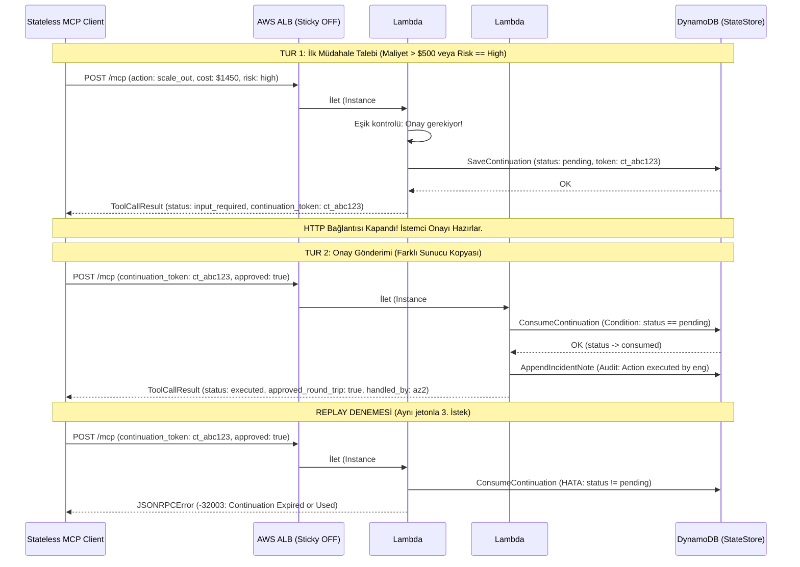

# Faz 2 / Step 2.2: Tool 2 (`execute_mitigation_plan`) ve SEP-2322 Multi-Round-Trip Akışı — Muhakeme Günlüğü

Bu doküman, `mcp-incident-commander` projesinin **Faz 2 / Step 2.2 (`internal/tools/mitigation_plan.go`)** adımında uygulanan **SEP-2322 Multi-Round-Trip** standardı, yüksek maliyet/risk kontrol eşikleri, devam jetonu (`continuation_token`) yaşam döngüsü ve çoklu sunucu kopyaları üzerinden asenkron onay mimarisinin tasarım gerekçelerini kayıt altına alır.

---

## 0. Görevin kapsamı ve genel yaklaşım

- **Kapsam sınırı:** **Faz 2 / Step 2.2** kapsamında 2. MCP aracı olan `execute_mitigation_plan` (`internal/tools/mitigation_plan.go`) kodlandı ve çok turlu onay akışını farklı Lambda kopyaları üzerinden simüle eden birim testler (`internal/tools/tools_test.go`) eklendi (`d46886c`).
- **Hedef:** FinOps maliyet eşiği (`estimated_cost_usd > 500`) veya operasyonel risk eşiği (`risk_level == "high"`) aşıldığında, istemci ile sunucu arasındaki HTTP bağlantısını açık tutmadan (stateless & connection-non-blocking) durumu `StateStore`'a kaydetmek; istemciye `InputRequiredResult` (`continuation_token` ile) dönmek ve istemcinin ikinci bir HTTP isteğiyle gönderdiği onayı farklı bir sunucu kopyasında başarıyla tamamlamak.
- **Genel strateji:**
  1. Eşik kontrolünü (`CostApprovalThresholdUSD = 500.0` ve `RiskLevelHigh = "high"`) açık sabitlerle belirleyip sihirli değerlerden kaçınmak.
  2. Jeton üretimini `crypto/rand` ile 128-bit kriptografik rastgelelikte (`ct_<32-hex>`) yaparak tahmin edilemez kılmak.
  3. `continuation_token` parametresini hem SEP-2322'nin standart `params.continuation_token` alanından hem de gevşek istemciler için `arguments.continuation_token` içinden okuyabilecek esnek bir girdi adaptasyonu sağlamak.
  4. Onay tamamlandığında olaya otomatik denetim (audit) izi bırakmak.

---

## 1. İlk inceleme

- **Step 2.1 depolama hazırlıklarının doğrulanması:** Step 2.1'de `StateStore` arayüzüne eklenen `SaveContinuation` ve `ConsumeContinuation` metodlarının bu akış için hazır olduğunu doğruladım. DynamoDB adaptörünün tek kullanımlık koşullu güncellemesi (`#st = :pending AND #ttl > :now_unix`) sayesinde Step 2.2'de veri katmanına ek kod yazmaya gerek kalmadı.
- **Sunucusuz (Serverless) mimari kısıtlarının değerlendirilmesi:** AWS Lambda maksimum çalışma süresi (timeout) ve Application Load Balancer (ALB) idle timeout (varsayılan 60s) kısıtları nedeniyle, insan onayı (Human-in-the-loop / Incident Commander) veya üst yönetim onayının uzun sürmesi durumunda bağlantıyı bekletmenin (long-polling / blocking HTTP) tamamen uygulanamaz olduğunu netleştirdim.

---

## 2. Mimari kararlar

### 2.1 İki turlu (Multi-Round-Trip) onay akışında bağlantının kapatılması vs. Bekletme

- **Karar:** Onay gereken durumlarda istemciyi hatta bekletmek yerine anında `status: "input_required"` ve `continuation_token` içeren bir `ToolCallResult` dönerek HTTP isteğini `200 OK` ile sonlandırdım (`internal/tools/mitigation_plan.go`).
- **Değerlendirdiğim alternatifler:**
  - **(A) HTTP bağlantısını açık tutup bir Go kanalı (`channel`) veya döngü ile onay gelene kadar beklemek (Long Polling / Synchronous Wait).**
  - **(B) WebSocket açarak çift yönlü soket üzerinden onay istemek.**
  - **(C) SEP-2322 standardına uygun olarak durumu DynamoDB'ye kaydedip `InputRequiredResult` ile bağlantıyı kapatmak; onayı 2. bağımsız HTTP isteğinde almak.**
- **Seçim ve gerekçe:** **(C)** seçildi.
  - Alternatif (A), Lambda faturalandırma maliyetini tavan yaptırır ve ALB/API Gateway zaman aşımına (504 Gateway Timeout) uğrar.
  - Alternatif (B), Stateless MCP (`2026-07-28`) prensibini ve sunucusuz mimarinin yatay ölçekleme yeteneğini tamamen bozar.
  - Alternatif (C), sunucu kopyasının belleğini serbest bırakır. İstemci onay kararını 1 saniye sonra da verse, 10 dakika sonra da verse, ikinci istek ALB üzerinden rastgele bambaşka bir Lambda kopyasına gidebilir ve `StateStore` üzerinden kesintisiz devam eder.

### 2.2 `continuation_token` girdi esnekliği: `params` vs. `arguments`

- **Karar:** `MitigationPlanTool.Execute` fonksiyonuna `paramContinuationToken` parametresi geçilmesini sağladım; aynı zamanda `MitigationPlanArgs` struct'ı içerisine de opsiyonel `ContinuationToken` alanı ekledim.
- **Değerlendirdiğim alternatifler:**
  - **(A) Jetonu yalnızca `ToolCallParams.ContinuationToken` (JSON-RPC `params` seviyesi) alanından kabul etmek.**
  - **(B) Jetonu yalnızca `arguments.continuation_token` içinden kabul etmek.**
  - **(C) Öncelikli olarak `params.continuation_token`'a bakmak, boşsa `arguments.continuation_token` fallback'ini işletmek.**
- **Seçim ve gerekçe:** **(C)** seçildi.
  - SEP-2322 şartnamesi `params._meta` seviyesinde veya `params` altında taşımayı önerirken, bazı genel MCP istemcileri (client SDK'ları) ek parametreleri doğrudan aracın `arguments` nesnesi içine koyabilir. İki konumu da desteklemek protokol uyumluluğunu maksimize eder.

### 2.3 Onay durumunun tek kullanımlık (Single-Use) tüketilmesi ve Replay engeli

- **Karar:** İkinci turda `store.ConsumeContinuation` çağrısı yaparak jetonu atomik olarak `consumed` durumuna çektim. Aynı jetonla tekrar istek gelirse `ErrCodeContinuationExpired` (`-32003`) hata kodu döndüm.
- **Değerlendirdiğim alternatifler:**
  - **(A) Jetonu veritabanından silmek (`DeleteItem`).**
  - **(B) Jetonu atomik olarak `consumed` durumuna çekip TTL süresince saklamak.**
- **Seçim ve gerekçe:** **(B)** seçildi.
  - `DeleteItem` yapıldığında mükerrer gelen bir istek "jeton hiç var olmadı" gibi algılanır. Durumu `consumed` olarak güncellemek ise denetim (audit) izini korur ve istemciye "jeton daha önce kullanıldı veya süresi doldu" şeklinde net bir protokol hatası (`-32003`) dönülmesini sağlar.

### 2.4 Denetim izi (Audit Trail) ve best-effort olay notu entegrasyonu

- **Karar:** Müdahale planı tamamlandığında (`executed` veya `aborted`), `t.store.AppendIncidentNote` çağrısı ile ilgili olayın zaman çizelgesine onaylayan mühendis ve yapılan işlem notunu ekledim.
- **Değerlendirdiğim alternatifler:**
  - **(A) Müdahale sonucunu sadece araç yanıtı olarak dönmek, olaya not düşmemek.**
  - **(B) Not ekleme başarısız olursa tüm işlemi geri almak (rollback).**
  - **(C) Müdahale sonucunu üretmek ve olay bağlamına best-effort (hata olsa dahi ana müdahaleyi bozmayan) denetim notu yazmak.**
- **Seçim ve gerekçe:** **(C)** seçildi.
  - FinOps ve SRE ekipleri için kimin hangi müdahaleyi ne zaman onayladığının olay geçmişinde (`IncidentContext.Notes`) yer alması kritik bir operasyonel gereksinimdir. Ancak olay notu yazma adımındaki olası geçici bir arıza, başarıyla uygulanan altyapı operasyonunu hatalı göstermemelidir.

---

## 3. SEP-2322 Multi-Round-Trip Akışı ve Durum Geçişleri

Aşağıdaki şema, yüksek maliyetli bir müdahalenin iki tur boyunca farklı Lambda kopyaları üzerinden nasıl işlendiğini gösterir:



---

## 4. Test / doğrulama stratejisi

`internal/tools/tools_test.go` içerisine eklenen `TestMitigationPlanTool_SEP2322MultiRoundTrip` birim testi ile şu senaryolar kanıtlandı:

1. **Düşük Maliyetli / Düşük Riskli Müdahale (Tek Tur):**
   - `estimated_cost_usd: 0` ve `risk_level: "low"` olan bir planın ilk çağrıda doğrudan `status: "completed"` ile çalıştığını kanıtlar.
2. **Yüksek Maliyetli / Yüksek Riskli Müdahale (Tur 1):**
   - `estimated_cost_usd: 1450.00` ve `risk_level: "high"` olan bir planın `lambdaInstance1` üzerinde çalıştırıldığında `status: "input_required"` ve geçerli bir `continuation_token` döndüğünü kanıtlar.
3. **Farklı Sunucu Kopyasında Onay Tamamlama (Tur 2):**
   - Üretilen jeton ve `approved: true` parametresiyle `lambdaInstance2` çağrıldığında işlemin başarıyla tamamlandığını (`approved_round_trip: true`, `handled_by_instance: "lambda-instance-az2"`) kanıtlar.
4. **Replay Saldırısı Engeli (Edge Case):**
   - Tüketilmiş `continuation_token` ile yapılan tekrar çağrının `mcp.ErrCodeContinuationExpired` (`-32003`) ile engellendiğini kanıtlar.

**Çalıştırılan doğrulama komutu ve çıktısı:**
```text
$ go vet ./... && go build ./... && go test -v -race ./...
=== RUN   TestIncidentContextTool_StatelessMultiInstanceStateSharing
--- PASS: TestIncidentContextTool_StatelessMultiInstanceStateSharing (0.00s)
=== RUN   TestMitigationPlanTool_SEP2322MultiRoundTrip
--- PASS: TestMitigationPlanTool_SEP2322MultiRoundTrip (0.00s)
PASS
ok  	mcp-incident-commander/internal/tools	1.661s
```

---

## 5. Doğrulamada ve kurulumda çıkan sorun(lar)

- **Git Index Kilit Dosyası Hatası (`.git/index.lock`):**
  - **Belirti:** `git add ... && git commit ...` komutu standart sandbox içinde `fatal: Unable to create '/Users/cemilcelik/Codebase/Antigravity/cloud-native-incident-commander/.git/index.lock': Operation not permitted` hatası verdi.
  - **Kök Neden:** Sandbox dosya sistemi kısıtlaması nedeniyle `.git` altındaki kilit dosyasına yazma izni verilmedi.
  - **Çözüm:** Komut `BypassSandbox: true` ile tekrar çalıştırılarak `d46886c` commit'i oluşturuldu.

---

## 6. Commit stratejisi

Step 2.2 kapsamındaki tüm araç kodu ve birim testler atomik olarak tek bir commit halinde kaydedildi:

- `d46886c` — `feat(tools): implement execute_mitigation_plan with SEP-2322 multi-round-trip flow`

---

## 7. Bilinçli olarak ertelenenler / açık noktalar

1. **Tool 3 (`live_telemetry_diagnostic`):** Streamable HTTP (SSE) üzerinden aşamalı telemetri aktarımı **Faz 2 / Step 2.3**'te kodlanacak.
2. **HTTP Router Seviyesinde Araç Orkestrasyonu:** `execute_mitigation_plan` aracının ana HTTP sunucusu ve SEP-2243 middleware zinciriyle bağlanması **Faz 3 / Step 3.1**'de yapılacak.

---

## 8. Kısa özet

| Karar | Seçim | Ana gerekçe |
| :--- | :--- | :--- |
| Onay mimarisi | SEP-2322 Multi-Round-Trip (`InputRequiredResult`) | Lambda ve ALB zaman aşımı risklerini ortadan kaldırmak; insan onayını bağlantıdan bağımsız kılmak. |
| Eşik kuralları | `estimated_cost_usd > 500` veya `risk_level == "high"` | FinOps maliyet risklerini ve kritik altyapı müdahalelerini garanti altına almak. |
| Jeton üretimi | `crypto/rand` tabanlı `ct_<hex>` | Kriptografik rastgelelik sağlayarak devam jetonlarının tahmin edilmesini engellemek. |
| Tek kullanımlık tüketim | Durum `consumed` güncellemesi + `-32003` hata kodu | Replay saldırılarını önlerken geriye dönük denetim izini korumak. |
| Denetim entegrasyonu | Best-effort `AppendIncidentNote` | Olay geçmişinde onaylayan mühendis ve yapılan müdahale izini kalıcı hale getirmek. |
