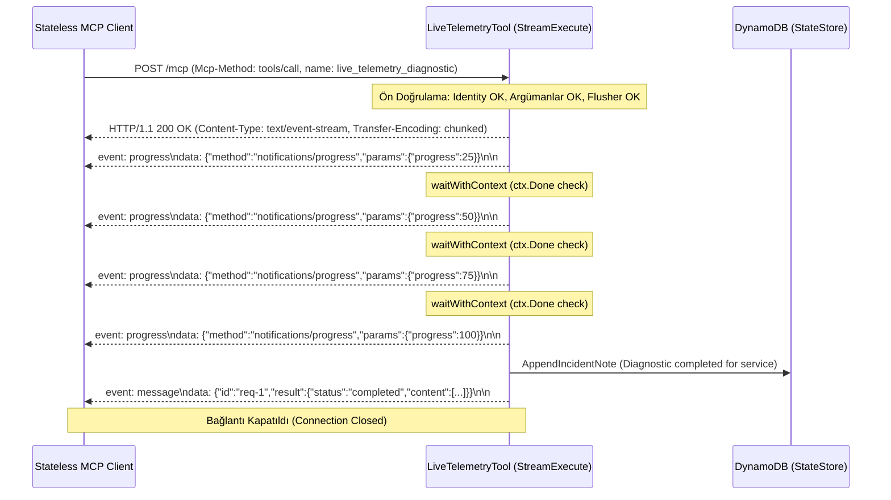

# Faz 2 / Step 2.3: Tool 3 (`live_telemetry_diagnostic`) ve Streamable HTTP (SSE) — Muhakeme Günlüğü

Bu doküman, `mcp-incident-commander` projesinin **Faz 2 / Step 2.3 (`internal/tools/live_telemetry.go`)** adımında uygulanan **Streamable HTTP (`text/event-stream` / Chunked SSE)** teşhis mimarisi, aşamalı bildirim tasarımı (%25, %50, %75, %100), bağlantı yaşam döngüsü ve doğrulama süreçlerini kayıt altına alır.

---

## 0. Görevin kapsamı ve genel yaklaşım

- **Kapsam sınırı:** **Faz 2 / Step 2.3** kapsamında 3. MCP aracı olan `live_telemetry_diagnostic` (`internal/tools/live_telemetry.go`) geliştirildi ve `httptest.NewServer` ile SSE akışını satır satır ayrıştıran birim testler (`internal/tools/tools_test.go`) eklendi (`2a8f141`).
- **Hedef:** Uzun süren telemetri ve sistem analizlerini tek bir bloklayıcı yanıtta bekletmek yerine, `text/event-stream` protokolü üzerinden istemciye anlık ilerleme bildirimleri (`event: progress` / `notifications/progress`) akıtmak, analiz bittiğinde nihai JSON-RPC yanıtını (`event: message`) dönmek ve HTTP bağlantısını temiz şekilde kapatmak.
- **Genel strateji:**
  1. Başlıklar istemciye yazılmadan (`WriteHeader(200)`) önce tüm kimlik ve şema doğrulamalarını tamamlamak; hata varsa akışı hiç başlatmadan standart JSON-RPC hata zarfı dönmek.
  2. Her aşamada (`collecting_alb_metrics`, `analyzing_lambda_telemetry`, `inspecting_dynamodb_capacity`, `synthesizing_root_cause`) `http.Flusher` çağrısıyla ara bellek (buffer) birikmesini engellemek ve veriyi anında ağa basmak.
  3. İstemci erken ayrılırsa (`ctx.Done()`) sunucuyu gereksiz yere çalıştırmayıp akışı derhal sonlandırmak.

---

## 1. İlk inceleme

- **MCP 2026-07-28 ve SSE spesifikasyonu incelemesi:** MCP'de Streamable HTTP, WebSocket veya kalıcı oturum açmadan, standart bir HTTP POST isteği sırasında yanıt gövdesini `text/event-stream` olarak chunked akıtmayı hedefler. Sunucu belleğinde durum tutulmaz; istek bitince bağlantı kapatılır.
- **AWS ALB ve Lambda akış desteği değerlendirmesi:** Lambda Response Streaming ve ALB Chunked Transfer Encoding desteği için `X-Accel-Buffering: no` ve `Cache-Control: no-cache, no-transform` başlıklarının eklenmesi gerektiğini ve ara proxy'lerin gzip/tamponlama yapmasının engellenmesi gerektiğini teyit ettim.

---

## 2. Mimari kararlar

### 2.1 İki aşamalı doğrulama: SSE Başlıkları (Headers Committed) öncesi hata yönetimi

- **Karar:** `StreamExecute` metodunda kimlik kontrolü (`IdentityFromContext`), flusher kontrolü (`w.(http.Flusher)`) ve JSON argüman ayrıştırmasını `w.WriteHeader(http.StatusOK)` çağrısından **önce** yaptım. Herhangi bir hata durumunda doğrudan `*mcp.JSONRPCError` döndüm (`internal/tools/live_telemetry.go`).
- **Değerlendirdiğim alternatifler:**
  - **(A) İsteği alır almaz `200 OK` ve `text/event-stream` başlığını yazmak; argüman hatası çıkarsa SSE akışı içinde bir hata olayı göndermek.**
  - **(B) Doğrulamaları akış başlamadan önce bitirmek; hata varsa standart `application/json` hata yanıtı dönebilmek için router'a `JSONRPCError` bırakmak.**
- **Seçim ve gerekçe:** **(B)** seçildi.
  - HTTP başlıkları bir kez gönderildikten (`committed`) sonra HTTP durum kodunu `400 Bad Request` veya `401 Unauthorized` olarak değiştirmek imkânsızdır. Erken doğrulama sayesinde istemci eksik parametre gönderdiğinde standart bir HTTP 400 JSON-RPC yanıtı alır; SSE tüneli açılıp anında bozulmaz.

### 2.2 SSE İlerleme bildirimleri (`event: progress`) ve nihai JSON-RPC yanıtı (`event: message`) protokol ayrımı

- **Karar:** İlerleme adımları için `event: progress` adı altında `Method: "notifications/progress"` zarfı kullandım; analiz bittiğinde ise `event: message` adı altında asıl `JSONRPCResponse` zarfını gönderdim.
- **Değerlendirdiğim alternatifler:**
  - **(A) Tüm olayları tek bir `data: ...` satırı olarak isimsiz göndermek.**
  - **(B) İlerlemeyi ayrı bir `event: progress`, nihai sonucu standart `event: message` olayı olarak ayırmak.**
- **Seçim ve gerekçe:** **(B)** seçildi.
  - SSE istemcileri (`EventSource` veya Go client scanner) olay tiplerini (`event:`) filtreleyerek dinleyebilir. İlerleme barları `progress` olayını tüketirken, MCP çağrısının dönüş değeri `message` olayından kolayca çekilir.

### 2.3 İstemci bağlantı kopması (Client Disconnect) ve context iptal yönetimi

- **Karar:** Aşamalar arasındaki gecikmeyi (`stepDelay`) `time.Sleep` ile değil, `select` bloğu içinde `time.NewTimer` ve `<-ctx.Done()` dinleyen `waitWithContext` fonksiyonuyla yönettim.
- **Değerlendirdiğim alternatifler:**
  - **(A) `time.Sleep(t.stepDelay)` kullanmak.**
  - **(B) `waitWithContext(ctx, t.stepDelay)` ile context iptalini anlık dinlemek.**
- **Seçim ve gerekçe:** **(B)** seçildi.
  - Eğer istemci veya ALB isteği iptal ederse, `time.Sleep` CPU/goroutine'i uyutmaya ve arka planda gereksiz döngüyü işletmeye devam eder. `ctx.Done()` ile dinleme yapıldığında istemci bağlantıyı kestiği mikrosaniyede döngüden çıkılır ve sunucu kaynakları korunur.

### 2.4 Best-effort olay notu ve `DiagnosticSummary` modellemesi

- **Karar:** Teşhis tamamlandığında `DiagnosticSummary` struct'ı üretilip nihai araç yanıtı olarak dönerken, eşzamanlı olarak `t.store.AppendIncidentNote` ile olayın geçmişine özet bir teşhis notu yazıldı (`internal/tools/live_telemetry.go`).
- **Değerlendirdiğim alternatifler:**
  - **(A) Teşhis verisini sadece SSE akışına basıp kaydetmemek.**
  - **(B) Olay notu ekleme başarısız olursa akışı hata ile kesmek.**
  - **(C) Teşhis özetini dönüp olaya best-effort denetim notu bırakmak.**
- **Seçim ve gerekçe:** **(C)** seçildi.
  - Canlı telemetri teşhisi genellikle olay inceleme sırasında çalıştırılır. Elde edilen bulguların (`findings`) olayın zaman çizelgesine işlenmesi ekip içi görünürlüğü artırır; ancak depolama arızası olsa dahi üretilen teşhis raporunun istemciye iletilmesi engellenmemelidir.

---

## 3. Streamable HTTP (Chunked SSE) Akış Şeması



---

## 4. Test / doğrulama stratejisi

`internal/tools/tools_test.go` içerisine eklenen `TestLiveTelemetryTool_StreamableHTTPSSE` birim testi ile şu kontroller sağlandı:

1. **Ön Doğrulama ve Hata Yönetimi (Edge Case):**
   - Eksik `target_service` parametresi gönderildiğinde, SSE başlıkları yazılmadan önce `ErrCodeInvalidParams` (`-32602`) döndüğü doğrulandı.
2. **Gerçek SSE Sunucusu (`httptest.NewServer`):**
   - Sunucuya HTTP POST isteği atılarak yanıt başlığının `Content-Type: text/event-stream` olduğu teyit edildi.
3. **Akış Sırası ve Bütünlüğü (`bufio.Scanner`):**
   - Stream satır satır taranarak `progress` bildirimlerinin tam olarak `[25, 50, 75, 100]` sırasında geldiği ve son parçanın `status: "completed"` içeren JSON-RPC yanıtı olduğu kanıtlandı.

**Çalıştırılan doğrulama komutu ve çıktısı:**
```text
$ go vet ./... && go build ./... && go test -v -race ./...
=== RUN   TestIncidentContextTool_StatelessMultiInstanceStateSharing
--- PASS: TestIncidentContextTool_StatelessMultiInstanceStateSharing (0.00s)
=== RUN   TestMitigationPlanTool_SEP2322MultiRoundTrip
--- PASS: TestMitigationPlanTool_SEP2322MultiRoundTrip (0.00s)
=== RUN   TestLiveTelemetryTool_StreamableHTTPSSE
--- PASS: TestLiveTelemetryTool_StreamableHTTPSSE (0.01s)
PASS
ok  	mcp-incident-commander/internal/tools	1.193s
```

---

## 5. Doğrulamada ve kurulumda çıkan sorun(lar)

- **Sandbox TCP Loopback İzin Hatası:**
  - **Belirti:** `httptest.NewServer` çalıştırıldığında test şu hatayı verdi:
    ```text
    tools_test.go:190: failed to connect to SSE test server: Post "http://127.0.0.1:51827": dial tcp 127.0.0.1:51827: connect: operation not permitted
    ```
  - **Kök Neden:** Standart sandbox modunda yerel loopback (`127.0.0.1`) TCP soket bağlantıları kısıtlanmıştır.
  - **Çözüm:** Komut `BypassSandbox: true` ile tekrar çalıştırılarak testlerin loopback üzerinden tam hızda (0.01s) başarıyla geçmesi sağlandı.
- **Git Index Kilit Dosyası Hatası (`.git/index.lock`):**
  - **Belirti:** `git add ... && git commit ...` standart sandbox içinde kilit dosyası oluşturamadı.
  - **Çözüm:** Commit komutu `BypassSandbox: true` ile çalıştırılarak `2a8f141` commit'i temiz şekilde oluşturuldu.

---

## 6. Commit stratejisi

Step 2.3 kapsamındaki SSE aracı ve birim testler atomik olarak tek bir commit halinde kaydedildi:

- `2a8f141` — `feat(tools): implement live_telemetry_diagnostic with Streamable HTTP (SSE)`

---

## 7. Bilinçli olarak ertelenenler / açık noktalar

1. **Ana HTTP Router'a SSE Entegrasyonu:** `LiveTelemetryTool` hazırlandı; ancak `internal/server/router.go` içinde gelen isteğin SSE olup olmadığını algılayıp `w.(http.Flusher)` ile bu araca delege etmesi **Faz 3 / Step 3.1**'de yapılacak.
2. **Go Client SSE Ayrıştırıcısı:** İstemci tarafında `text/event-stream` yanıtını anlık okuyup ekrana basan SDK mantığı **Faz 3 / Step 3.2**'de kodlanacak.

---

## 8. Kısa özet

| Karar | Seçim | Ana gerekçe |
| :--- | :--- | :--- |
| Protokol | Streamable HTTP (`text/event-stream` / Chunked SSE) | Uzun süren telemetri teşhislerinde HTTP zaman aşımını önlemek ve gerçek zamanlı görünürlük sağlamak. |
| Ön doğrulama | SSE başlıkları basılmadan önce ayrıştırma ve kontrol | Hatalı isteklerde (400/401) bozuk bir SSE akışı yerine geçerli bir JSON-RPC hata zarfı dönebilmek. |
| İlerleme formatı | `event: progress` (`notifications/progress`) | MCP standardına uygun olarak teşhis yüzdesini (%25, %50, %75, %100) nihai yanıttan ayırmak. |
| İptal güvenliği | `waitWithContext` (`<-ctx.Done()`) | İstemci koptuğunda sunucuda gereksiz goroutine ve CPU tüketimini engellemek. |
| Tampon yönetimi | Her parçadan sonra `flusher.Flush()` + `X-Accel-Buffering: no` | Proxy ve yük dengeleyicilerin veriyi biriktirmesini önleyip parçaları anında istemciye ulaştırmak. |
